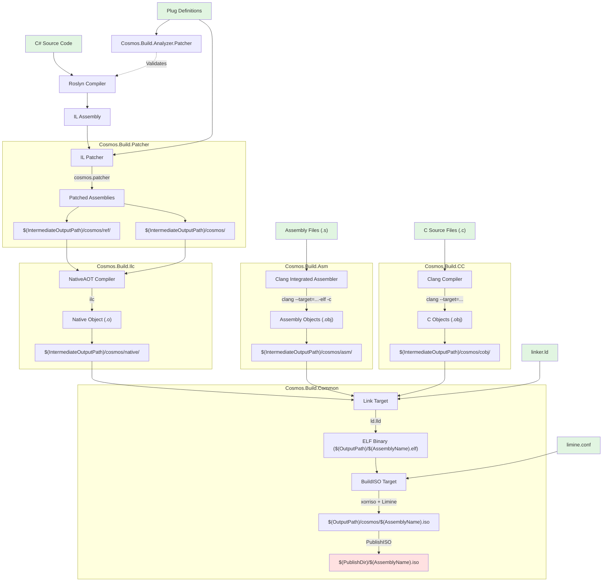

# How Cosmos works and how it slips custom tasks to .NET
Cosmos uses MSBuild to give custom tasks on build time and that is mostly what happens. That is not the only thing what Cosmos does.

## Slipping in custom tasks
In C# you can use the Microsoft.Build packages for buiding out custom tasks.
The Task class needs to inherit from Task class or implement ITask interface.
This means that the C# compiler (or Roslyn) is compiling a dll that has a task for MSBuild to execute.

A example MSBuild is down below.
```C#
using Microsoft.Build.Framework;
using Microsoft.Build.Utilities;

public class SayHelloTask : Task
{
    [Required]
    public string GreetingName { get; set; }

    public override bool Execute()
    {
        Log.LogMessage(MessageImportance.High, $"Hello, {GreetingName} from a custom .NET build task!");
        return true;
    }
}
```

Of course you would have to modify the .csproj file to get it working for that as well, but that would be the code for a really basic task.

## How Cosmos works
As Cosmos is basicly a API for making Operating Systems using .NET, it also has to provide a lot for the kernel.

Here's what it provides:
* Filesystems
* Graphics
* (Recently added) a Driver kit for making your own drivers
* Power management via ACPI (Currently LAI, at some point uACPI)
* Plugged .NET functions, methods and classes
* Memory management
* Garbage collector
* A lot more stuff

### How Cosmos builds your project
Cosmos gen3 uses .NETs NativeAOT to compile a .ISO file and to boot it uses limine.

So here's the flow chart on kernel compilation:


Flowchart from the official Cosmos Gen3 developer documentation. Check the [official documentation](https://cosmosos.github.io/).